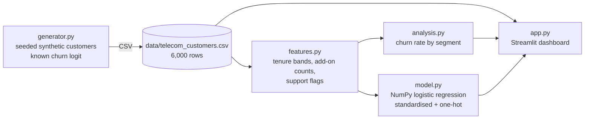

# Telecom Churn Analysis


A Data Analytics project on telecom customer churn: exploratory analysis
of 6,000 seeded synthetic customers, predictive feature engineering, and
a NumPy logistic-regression churn model — with a Streamlit dashboard that
lets you explore churn by segment and score any customer profile live.

**Live demo:** https://telecom-churn-analysis.streamlit.app

## What the data shows

On the seeded data (churn rate 28.7%):

- **Contract dominates.** Month-to-month customers churn at 45.1%,
  vs 12.4% on two-year contracts.
- **Tenure protects.** Churn falls steeply as tenure rises — the
  0–12 month band is the riskiest cohort.
- **Fibre + electronic cheque + no tech support** all raise churn,
  and the model recovers each of those effects with the right sign.
- **Model quality:** test AUC 0.805, accuracy 76.9% (hold-out of 1,200
  customers) — good discrimination for a model with no black box.

## Architecture



## Features

- **Seeded synthetic generator** — churn driven by a known logit
  (contract, fibre, electronic cheque, tenure, monthly charges,
  tech support, senior status, partner), so the analysis recovers
  real, checkable structure
- **EDA by segment** — churn rate by contract, tenure band, internet
  service and payment method, plus charges for churned vs retained
- **Predictive feature engineering** — tenure bands, add-on counts,
  no-tech-support flag, new/long-term customer flags,
  average monthly spend
- **NumPy logistic regression** — gradient descent with L2
  regularisation, standardised numerics, one-hot categoricals;
  no scikit-learn dependency, coefficients readable as drivers
- **Model evaluation** — accuracy, precision, recall, F1 and AUC
  (Mann-Whitney) on a deterministic 80/20 split
- **Live risk calculator** — tenure, charges, contract, internet,
  payment, tech support and senior/partner inputs scored in real time

## Quickstart

```bash
pip install -r requirements.txt

# Regenerate the demo dataset (seeded, deterministic)
python data/make_demo.py

# Run the analysis + model from Python
PYTHONPATH=src python -c "
import pandas as pd
from churn.analysis import summary
from churn.model import train_churn_model
df = pd.read_csv('data/telecom_customers.csv')
print(summary(df))
print(train_churn_model(df)['test'])
"

# Run the tests
PYTHONPATH=src pytest -q

# Launch the dashboard
streamlit run app.py
```

## Project structure

```
telecom-churn-analysis/
├── app.py                    # Streamlit dashboard (EDA + model + calculator)
├── data/
│   ├── make_demo.py          # regenerates data/telecom_customers.csv (seed 42)
│   └── telecom_customers.csv # committed demo dataset (6,000 customers)
├── src/churn/
│   ├── generator.py          # synthetic customer generator (known churn logit)
│   ├── features.py           # feature engineering (bands, add-ons, flags)
│   ├── model.py              # NumPy logistic regression + AUC/metrics
│   └── analysis.py           # churn-rate-by-segment summaries
├── tests/
│   ├── test_generator.py     # determinism, churn rate, contract effect
│   ├── test_features.py      # tenure bands, add-on counts, flags
│   ├── test_model.py         # AUC > 0.60, contract coefficient positive
│   └── test_analysis.py      # segment totals, summary sanity
├── requirements.txt
├── Dockerfile
└── README.md
```

## Production extensions

What this demo stands in for, and how it would harden for production:

- **Real CRM / warehouse data** — replace the seeded CSV with a
  warehouse extract (dbt models, contract + billing + support tables);
  the feature code is already written against a flat customer grain
- **Gradient boosting + calibration** — swap the logistic model for
  HistGradientBoosting / XGBoost with calibrated probabilities when
  discrimination, not interpretability, is the priority
- **Survival analysis** — churn is a time-to-event problem; a Cox or
  Kaplan–Meier layer would answer "when", not just "whether"
- **Leakage audit** — enforce a point-in-time feature cut-off so no
  post-churn information (final bill, cancellation reason) enters
  training features
- **Drift + fairness monitoring** — track churn rate, AUC and
  calibration by segment over time, and check the model does not
  penalise protected groups
- **Retention actions, not just scores** — join the score to an
  intervention (contract offer, support bundle) and A/B test it,
  so the model's business value is measured, not assumed
